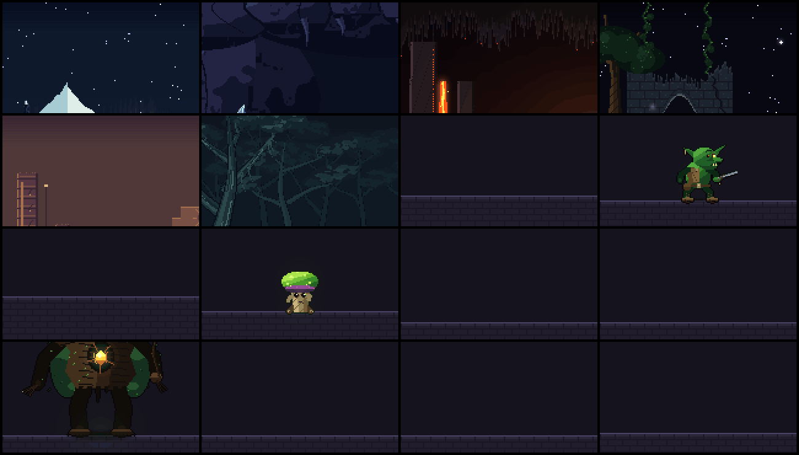

<p align="center">
  
</p>

**Languages / 语言:** [English](README.md) · [简体中文](README.zh-CN.md)

# pixelfx-extended.

An extended [**pixelfx**](https://github.com/patch-gg/pixelfx) fork with **<!-- new-count -->16<!-- /new-count -->** additional maps, minions, bosses and effects beyond the original 244-effect baseline.

**<!-- count -->260<!-- /count --> pixel art effects and animations, every one a small piece of code.** Fire,
explosions, magic, weather, UI, pickups, critters and more. Play them live, recolor and mirror them, drop them into
a browser game, or export sprite sheets for any engine. Plus a **fantasy game kit** — battle maps, minion units,
telegraphed boss attacks and choreographed encounters — and a Claude Code skill that makes new ones the way a picky
pixel artist would: draft, render, look, refine.

The library is **<!-- original-count -->244<!-- /original-count --> original effects and **<!-- new-count -->16<!-- /new-count --> new ones**. The [gallery](gallery/index.html) marks every item `original` or `new` and filters by it.

Every effect that involves a character is **acted out**: he winds up, lets go, freezes on contact and recovers, and a
target takes the hit. Twelve whole moves chain the effects into attacks from wind-up to recovery.

**[open the gallery](https://patch-gg.github.io/pixelfx/)** · [fantasy encounters](https://patch-gg.github.io/pixelfx/fantasy.html) ·
[catalog](docs/CATALOG.md) · [fantasy kit](docs/FANTASY.md) · [acting](#acting) · [the skill](#the-skill) ·
[make your own](#make-your-own) · [how it works](#how-it-works)

The method is [Hugo Duprez](https://x.com/HugoDuprez)'s, from [How to make (good) pixel art effects with
Claude](https://www.spritefusion.com/blog/how-to-make-good-pixel-art-effects-with-claude): code is clay, trust your
eyes, feed your references. His [open-source effects](https://www.spritefusion.com/pixel-art-vfx) at Sprite Fusion
set the bar, and `src/core/sim.js` and the effects that say so at the top adapt his code. This repo is our take on
the idea at library scale, with a skill to keep going.

## new additions.

These **<!-- new-count -->16<!-- /new-count -->** pieces are not in the original 244-effect baseline: fantasy maps, minions, bosses and more. Browse them in the [gallery (`?source=new`)](gallery/index.html?source=new).

<p align="center">
  
</p>

<!-- new-catalog -->
| category | effect | id |
|---|---|---|
| **world** | Aurora Pass | `world/aurora-pass` |
| **world** | Crystal Hollow | `world/crystal-hollow` |
| **world** | Ember Depths | `world/ember-depths` |
| **world** | Mossy Ruins | `world/mossy-ruins` |
| **world** | Sunscar Temple | `world/sunscar-temple` |
| **world** | Wisp Marsh | `world/wisp-marsh` |
| **mobs** | Goblin Jab | `mobs/goblin-jab` |
| **mobs** | Goblin Raider | `mobs/goblin-raider` |
| **mobs** | Spore Puff | `mobs/spore-puff` |
| **mobs** | Sporeling | `mobs/sporeling` |
| **boss** | Phase Roar | `boss/phase-roar` |
| **boss** | Root Quake | `boss/root-quake` |
| **boss** | Thorn King | `boss/thorn-king` |
| **boss** | Thorn Volley | `boss/thorn-volley` |
| **spawn** | Shanhaijing summon | `spawn/shanhaijing-summon` |
| **lightning** | Storm sigil | `lightning/storm-sigil` |
<!-- /new-catalog -->

## what's in it.

Categories with new content appear first; samples list **new** effects before original ones.

<!-- catalog -->
| category | effects | some of them |
|---|---|---|
| **world** | 6 | aurora pass, crystal hollow, ember depths, mossy ruins, sunscar temple, wisp marsh |
| **mobs** | 4 | goblin jab, goblin raider, spore puff, sporeling |
| **boss** | 4 | phase roar, root quake, thorn king, thorn volley |
| **lightning** | 12 | storm sigil, ball lightning, chain lightning, charge up, electrified, lightning strike… |
| **spawn & death** | 11 | shanhaijing summon, coin drop, disintegrate, dissolve burn, egg hatch, poof… |
| **moves** | 12 | arrow shot, dash strike, earth stomp, fireball throw, ground pound, holy smite… |
| **fire** | 12 | brazier, campfire, candle, fire breath, fire ring, fire tornado… |
| **explosions** | 12 | barrel explosion, big explosion, cartoon pow, dirt explosion, firework burst, firework rocket… |
| **water** | 12 | bubbles, drip, fountain, geyser, rain splash, ripples… |
| **ice** | 10 | blizzard vortex, freeze, frost breath, frost nova, ice crystal, ice lance… |
| **sci-fi** | 12 | emp blast, energy core, force field, glitch, hologram, jetpack… |
| **melee** | 12 | claw swipe, dagger flurry, double slash, hammer smash, heavy cleave, scythe reap… |
| **impacts** | 11 | blunt hit, bullet impact, critical hit, ground slam, heavy landing, hit flash… |
| **projectiles** | 13 | arrow, bullet tracer, cannon shot, energy disc, signal flare, homing missile… |
| **arcane** | 12 | arcane beam, arcane missiles, arcane orb, blink in, blink out, magic circle cast… |
| **holy** | 10 | blessing, divine shield, feather burst, halo, heal, healing ring… |
| **shadow** | 12 | black hole, curse, dark explosion, eclipse, grasping hands, hex sigil… |
| **status** | 13 | bleeding, burning, charmed, confused, cursed, frozen… |
| **nature** | 13 | acid splash, boulder, earth spike, healing bloom, leaf storm, poison cloud… |
| **weather** | 12 | aurora, blizzard, cherry blossoms, clouds, falling leaves, fireflies… |
| **ui** | 12 | achievement, coin collect, combo counter, confetti, countdown, crit number… |
| **pickups** | 11 | chest open, coin spin, collect burst, crystal shard, gem spin, heart pickup… |
| **transitions** | 10 | blinds, burn away, crt off, diamond wipe, glitch wipe, iris… |
| **critters** | 12 | bat, bird, butterfly, eyeball, fish school, flying skull… |
<!-- /catalog -->

Every effect is a file in `src/fx/<category>/<name>.js`. The [catalog](docs/CATALOG.md) lists them all.

## fantasy game kit.

The library also carries the things a fantasy game needs around its effects. They use the same files, buffers,
palette options and tooling, and add one export each:

| piece | folder | what it carries |
|---|---|---|
| **maps** | `src/fx/world/` | 320×180 looping arenas with a `map` export: `groundY`, walkable spans, platforms, hero/mob/boss spawns |
| **minions** | `src/fx/mobs/` | looping units with `hp`, radius, speed and a list of attacks; their attack effects are separate modules |
| **bosses** | `src/fx/boss/` | large loops with health, phases and a suite of telegraphed attacks |
| **boss attacks** | `src/fx/boss/` | screen-wide telegraphs, quakes, volleys and phase transitions, with hit timings |
| **encounters** | `src/encounters/` | a map, a hero, minions, a boss and its attacks on one timeline, from 14 s skirmishes to 30 s two-phase fights |

Play the two sample encounters: **[Ashfall Skirmish](https://patch-gg.github.io/pixelfx/fantasy.html?enc=ember-skirmish)** and
**[The Verdant Throne](https://patch-gg.github.io/pixelfx/fantasy.html?enc=verdant-throne)**. The browser page and the render tools share the
same `createEncounter` runtime.

```bash
node tools/new.mjs world/mossy-crypt --map       # a battle map with a layout
node tools/new.mjs mobs/rat-scout --mob          # a looping minion
node tools/new.mjs mobs/rat-bite --mob-attack    # its attack effect
node tools/new.mjs boss/bog-witch --boss         # a boss unit
node tools/new.mjs boss/bog-nova --boss-attack   # a telegraphed move
node tools/new.mjs bog-witch --encounter         # the timeline that plays them

node tools/map.mjs world/mossy-ruins             # contact + layout + gameplay images
node tools/encounter.mjs verdant-throne --mp4    # contact sheet, timeline JSON and video
```

Every new piece is checked like an effect: `npm run check` verifies the map's floor and spawns, the boss's phases,
hit timings inside their effects, timeline order and that the encounter can actually finish. `node tools/index.mjs`
regenerates the registries and [catalog](docs/CATALOG.md)/[encounter catalog](docs/ENCOUNTERS.md). The full data contract,
design checklists and integration snippet are in [docs/FANTASY.md](docs/FANTASY.md).

## use one.

**In a browser game** (canvas, Phaser, PixiJS, Kaplay, three.js), use the code. No dependencies.

```js
import { createFrame, clearFrame, createFx, composite } from "pixelfx";
import * as frostNova from "pixelfx/fx/ice/frost-nova";

const frame = createFrame(320, 180);                   // your game's pixel resolution
const img = new ImageData(320, 180);
const fx = createFx(frostNova, { x: 160, y: 140 });   // also: flip, angle, seed, palette, light...

function tick(dt) {
  fx.update(dt);
  clearFrame(frame);
  fx.draw(frame, "back");                              // behind characters
  drawCharacters();
  fx.draw(frame, "front");
  composite(frame, img.data, backgroundColor);         // color, then light added on top
  ctx.putImageData(img, 0, 0);                         // scale up with image-rendering: pixelated
}
```

Install from GitHub with `npm i github:patch-gg/pixelfx`, or copy `src/core` and the effects you want.

**In any engine** (Godot, Unity, GameMaker, Defold, LÖVE, Bevy), use sprite sheets:

```bash
node tools/render.mjs ice/frost-nova --sheet
```

That writes a transparent PNG of every frame in a grid and an Aseprite-style JSON (frame rects, durations, and
`meta.pixelfx` with fps, loop, columns and the pivot). Phaser's atlas loader and the Aseprite importers for Godot
and Unity read it. `node tools/sheets.mjs` exports the whole library to `sheets/`.

### Cocos Creator

Export the effects directly into a Cocos Creator project's resources folder. This creates transparent PNG/JSON assets for every effect plus an index, splitting long animations into 2048px-safe pages when needed, so all effects use the same runtime component:

```bash
npm run cocos:export -- fire/torch
node tools/cocos.mjs fire ice moves/sword-combo --out ../pixelfx-cocos/assets/resources/pixelfx
node tools/cocos.mjs --out ../my-game/assets/resources/pixelfx
```

Copy [`cocos/runtime/PixelfxSprite.ts`](cocos/runtime/PixelfxSprite.ts) into your Cocos project's `assets/scripts/pixelfx/`, attach it next to a Cocos `Sprite`, and set `effectId` to an id such as `fire/campfire`. It handles loading, nearest-neighbour filtering, the exported pivot, playback speed, looping and auto-destroy. See [`cocos/README.md`](cocos/README.md) for the full setup and API.

The companion repo [**pixelfx-cocos**](https://github.com/hanhandi-git/pixelfx-cocos) holds the Creator 3.8.8 preview workbench (`assets/scenes/Main.scene`). Clone it as a sibling of this checkout so `npm run cocos:export` writes to `../pixelfx-cocos/assets/resources/pixelfx/`:

```bash
git clone https://github.com/hanhandi-git/pixelfx-cocos.git ../pixelfx-cocos
```

Open that project in Creator and press **Preview** to filter by category, select an effect, and control playback. Generated PNG/JSON live only under `pixelfx-cocos/assets/resources/pixelfx/`, not in this library checkout.

### Standalone H5 workbench

For a browser-only preview with no Cocos Creator dependency, run:

```bash
npm run workbench
```

Open [http://localhost:8080/gallery/workbench.html](http://localhost:8080/gallery/workbench.html). It imports the effect modules directly, supports category filtering and search, and provides play, pause, replay, previous/next and speed controls. `npm run build:web` emits the static page under `dist/gallery/workbench.html`.

The workbench marks every effect `original` or `new` and filters by source; `?source=new` opens the 12 additions
directly. The standalone gallery has the same source filter. For the fantasy kit, the same server plays the encounter timeline at
[http://localhost:8080/gallery/fantasy.html](http://localhost:8080/gallery/fantasy.html): choose an encounter, jump to a
phase, replay it and change speed. `npm run build:web` also copies it to `dist/gallery/fantasy.html`.

Link to a specific effect with `?fx=<category>/<name>`, for example
[Storm sigil](http://localhost:8080/gallery/workbench.html?fx=lightning/storm-sigil). Selecting an effect updates
the URL, so a refresh keeps the selection. After adding an effect in `src/fx/`, run `node tools/index.mjs` and
refresh the workbench; rebuild with `npm run build:web` when using the static `dist/gallery` version.

Any effect takes a `palette` (a dark-to-bright ramp of hex colors), so a fire can burn blue and a heal can glow
pink without touching its code:

```bash
node tools/render.mjs fire/torch --gif --opts '{"palette": ["#102","#215","#43a","#8cf","#cff","#fff"]}'
```

## acting.

<p align="center">
  
</p>

An effect on its own looks like a sticker. What sells a hit is the body around it: the wind-up that says something is
coming, the freeze on contact, the target rocking back, the recovery. So the 61 effects with a character, and the 12
moves, say what the body does and when:

```js
export const act = {
  target: { x: 58 },
  poses: [
    [-0.55, GUARD],            // he starts before the effect does (t = 0 is the effect's first frame)
    [-0.3, WIND_UP],
    [0, CUT, "snap"],          // "snap" holds the last pose and jumps on the key
    [0.06, FOLLOW_THROUGH, "snap"],
    [0.86, GUARD],
  ],
  hits: [{ t: 0.06, stop: 0.14, shake: 0.18, amp: 2, push: 2.8, straw: 18 }],   // freeze for 0.14 s on contact
};
```

**Play the whole thing**, character and target included, by swapping `createFx` for `createAct`:

```js
import { createFrame, clearFrame, createAct, composite } from "pixelfx";
import * as slash from "pixelfx/fx/melee/sword-slash";

const act = createAct(slash, { x: 80, y: 140 });

function tick(dt) {
  act.update(dt);                                  // holds still by itself during a freeze
  clearFrame(frame);
  act.draw(frame);                                 // { body: false } and { target: false } leave them out
  composite(frame, img.data, backgroundColor);
  const [sx, sy] = act.shake;                      // throw the picture this far
  ctx.putImageData(img, sx, sy);
}
```

**Got your own character?** Effect ids haven't changed and a sprite sheet is still the effect alone, so existing games
keep working. (Effects drawn on the body paint the stock dummy, so regenerate those if you ship them.) The timing is plain data: read `slash.act`, or `meta.pixelfx.act` in a sprite sheet's
JSON (`windup`, `recovery`, `hits` with `t` and `freeze`, `poses`). Start your own wind-up animation that long before the effect, and
stop updating everything for `freeze` seconds at each hit.

Effects drawn on the body (frost, poison, a scan line) are written against the standing character and follow him
wherever he goes: each pixel of a pose knows which pixel of the standing body it came from. `node tools/act.mjs
<id> --sheet` bakes a whole act, character included, into a sprite sheet.

The body is yours to use too: `skeleton(pose)` gives you every joint of a pose in 3D, to hang your own things on, and
`posedParts(pose)` gives you each part drawn on its own.

## the skill.

The `pixelfx` skill teaches Claude Code to find, use, export and make effects — and to build the fantasy kit around them. Install it as a plugin:

```
/plugin marketplace add patch-gg/pixelfx
/plugin install pixelfx@pixelfx
```

or copy `skills/pixelfx` into `~/.claude/skills/`. Then ask for what you want:

- "Add a frost nova to my mage's ultimate."
- "Make five takes on a coin pickup sparkle and show me the best two."
- "Export the fire and explosions categories as sprite sheets for Godot."
- "This hit effect feels floaty. Make it punchier."
- "Give this spell a wind-up and make the enemy react to it."
- "Lay out a moonlit ruins arena for a two-phase boss fight."
- "Make a goblin minion, its dagger attack and a wave encounter."
- "Design a forest boss with a root quake, a thorn volley and a phase roar."

## make your own.

```bash
node tools/new.mjs arcane/my-spell       # a working starting point (add --loop for a loop)
node tools/render.mjs arcane/my-spell    # records/arcane/my-spell/contact.png: look at it
node tools/check.mjs arcane/my-spell     # spills, seams, unseeded randomness, slow frames
```

For a fantasy scene, start from a role template and preview the piece that matters:

```bash
node tools/new.mjs world/my-arena --map        # then: node tools/map.mjs world/my-arena
node tools/new.mjs mobs/my-slime --mob         # then: node tools/new.mjs mobs/my-slime-bite --mob-attack
node tools/new.mjs boss/my-warden --boss       # then: node tools/new.mjs boss/my-warden-quake --boss-attack
node tools/new.mjs my-fight --encounter        # then: node tools/encounter.mjs my-fight --mp4
```

Then go round: look at the contact sheet, fix the worst thing, render again. `--gif` and `--mp4` show the motion,
`--all` shows every frame. `node tools/act.mjs arcane/my-spell` shows an act as consecutive 12 fps steps, because motion
bugs don't show in samples. [docs/AUTHORING.md](docs/AUTHORING.md) has the contract, the drawing API and the quality
bar. `node tools/serve.mjs` runs the gallery locally with your effects in it.

## how it works.

- **Two kinds of effect, no images.** Pure effects export `draw(p, t, o)`, the frame at `t` seconds from `t` alone, so
  loops tile with no seam. Simulated effects export `create(o)` and step real particles, debris and lights at 120 Hz,
  so sparks bounce and smoke rolls the same at any frame rate.
- **Two buffers.** `color` takes pixels: opaque, dithered or truly translucent. `light` takes additive glow, added on
  top. Hot things look hot because of the light buffer.
- **Seeded everything.** Every random number comes from the effect's seed, so frame 40 is the same every time.
- **Local space.** Effects draw around their own origin; the painter places, mirrors and rotates them. Directional
  effects face right. A 24×38 stock character stands in for status effects, auras and hits.
- **A real skeleton, drawn down to pixels.** The grey dummy is neutral on purpose, so the eye goes to the move and any effect's
  colors read on it. He's a 3D skeleton with fixed-length bones, pelvis to spine to shoulders, rendered in a few flat tones with one clean
  ink line, the way Dead Cells makes its sprites. So he can twist, bend and really turn round, and depth decides what's in front. Poses hold on 12 fps
  steps, the way hand-drawn sprites do, while particles run at full rate.
- **Same frame shape as Sprite Fusion's VFX** (`{ w, h, ox, oy, color, light }`), so both libraries can draw into
  one frame.
- **Fantasy roles are data, not a second runtime.** A map is a 320×180 loop with a layout export; a mob/boss is a unit
  loop with stats; an attack is a one-shot with hit timings; an encounter places them on a timeline. `createEncounter`
  draws the fight and the boss bar, and the same timeline powers the tools and the browser page.

## license.

MIT, code and effects. Use them in anything, commercial included. Parts are adapted from Hugo Duprez's MIT effects
and from Hollow Crown's MIT source, and the Patch Pixel font in `gallery/fonts` is Patch's own and not covered: see
[NOTICE.md](NOTICE.md).

Made by [Patch](https://patch.gg).
