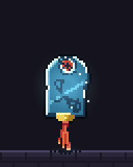
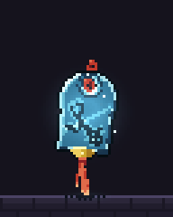

# 玉坠：让浮雕和悬挂感在 1x 下读出来

| 项目 | 值 |
|---|---|
| 效果 ID | `pickups/jade-pendant` |
| 类型 | 循环 pickup（64×80，2.8s） |
| 优化前 commit | `3c340ed` |
| 优化后 commit | `955dfa2` |
| 源文件 | [jade-pendant.js](../../src/fx/pickups/jade-pendant.js) |

## 优化前



整体已经是一块玉牌，但 1x 下更像“发光的绿色椭圆”：受光侧有一整圈白边，云纹浮雕几乎看不见，顶部也没有明显的绳结，悬挂感偏弱。

## 问题

1. **白边太完整。** `e < 1` 的受光边缘几乎全部用白/极浅色，形成一圈描边，和玉的体块脱节。
2. **浮雕对比不足。** 云纹只把色阶压低一级，在 1x 下和玉石本色混在一起。
3. **缺少可见的绳结。** 孔里只有一个红圈，没有向上延伸的绳，玉牌像悬空的。
4. **摆动太轻。** 0.07 rad 的摆角加上接近刚性的流苏，画面更像轻微呼吸，不像挂着的东西。

## 优化思路

### 1. 用受光方向决定倒角，而不是统一描白边

仍然保留 1px 倒角，但把颜色拆成三层：最亮的左上角用 `C[6]`，其余受光边用 `C[5]`，背光边直接落到深色。

```js
if (e < 1) idx = b > 0.85 ? 6 : b > 0.14 ? 5 : 2;
```

这样玉牌有一圈“玉的薄边”，但不会变成白色贴纸。

### 2. 云纹是刻进去的，不是染上去的

把浮雕纹路直接压到最深的玉色，并在它的右下方补一条受光壁。光从左上打来，凹槽的右下壁会亮：

```js
if (relief(u, v)) return C[1];                       // 深雕
if (relief(u, v + 1.3) || relief(u + 1.3, v))
  idx = Math.min(6, idx + 1);                       // 右下受光壁
```

1x 下能读到的不是纹理细节，而是“深线 + 亮线”的对比；4x 下才看得到完整的云卷。

### 3. 把绳结画在玉牌后面

从孔洞中心向上拉一条红绳到玉牌顶部之外，再在顶端打一个环。因为画在 `Layer` 之前，绳被玉牌自然遮住，只在顶部露出 2–3px：

```js
const [cx0, cy0] = at(0, -11.6), [cx1, cy1] = at(0, -18.6);
p.line(cx0, cy0, cx1, cy1, TH[2], 0.9);
p.ring(cx1, cy1, 2.1, 1, TH[4], 0.95);
```

这一步比加更多光效更能说明“这是一块挂着的玉”。

### 4. 摆动和流苏分两层

- 玉牌摆角从 `0.07` 提到 `0.15`，让轮廓在 1x 下有 1–2px 的横向变化。
- 流苏不跟玉牌同相，给 0.35 的相位滞后和 2.4px 的幅度；它是被玉牌“带起来”的次级运动。

```js
const pose = (ph) => ({
  y: -HOVER - 1.8 * Math.sin(ph * TAU),
  a: 0.15 * Math.sin(ph * TAU + 0.8),
});
// tassel
const sway = Math.sin(ph * TAU + 0.35 + i * 0.65) * 2.4;
```

## 优化后



变化点：

- 白边只在最受光的左上角出现，其余是浅玉色薄边。
- 云纹在 1x 下能看出深色刻线和受光壁。
- 顶部有红绳和绳环，玉牌真正“挂”起来了。
- 摆动更明显，流苏带滞后。

## 验证

```bash
node tools/check.mjs pickups/jade-pendant   # 1 pass
npm run check                                # 295 pass, 0 fail
npm test                                     # 29 pass
npm run build:web                            # 构建成功
```

`npm run check` 的既有 warning（`spawn/talisman-suppression` 越界）与本次无关。

## 可复用清单

- [ ] **倒角是否按光向分层？** 不要用一圈同色描边代替体积。
- [ ] **雕刻在 1x 下能读吗？** 深线 + 受光壁比“整体降一级色阶”有效。
- [ ] **悬挂物有物理连接吗？** 绳、环、孔要能连起来；画在主体后面比画在表面更自然。
- [ ] **主摆动和次级摆动分开了吗？** 流苏/飘带晚 1–3 帧，幅度更大。
- [ ] **白/亮色面积是否失控？** 玉石的主色要占主体，亮边只做轮廓提示。
