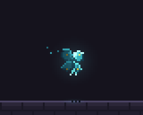
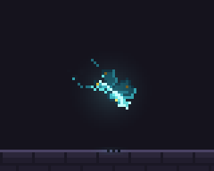

# 灵蝶：从“贴图平移”到会转弯的飞行

| 项目 | 值 |
|---|---|
| 效果 ID | `pickups/spirit-butterfly` |
| 类型 | 循环 pickup（80×64，2.4s） |
| 优化前 commit | `f7b9bff` |
| 优化后 commit | `5da4209` |
| 参考 | XP orb 的飞行尾迹、Potion 的呼吸感、Coin spin 的旋转主体 |
| 源文件 | [spirit-butterfly.js](../../src/fx/pickups/spirit-butterfly.js) |

> 迭代过程：v1（未提交）是 7 次/循环、完全朝上、无路径变速，已经明显像贴图；`f7b9bff` 先加了 11 次扑翼、浮沉、侧倾和 0.22 的相位变速，但朝向问题没解决；`5da4209` 才把“朝向 + 转弯 + 冲刺”补齐。下面的 before 是 `f7b9bff`，after 是 `5da4209`。

## 优化前



这一版已经不是完全静止的图标：有 11 次/循环的扑翼、随扑翼的上下浮沉、轻微的侧倾，以及路径上的加速/减速。但在 1x 下看，它仍然像**一个始终朝上的图标沿着路线平移**。

## 问题

1. **朝向和运动解耦。** 身体永远朝屏幕上方，路径转向时主体不跟着转；眼睛看到的是“位移”，不是“飞行”。
2. **扑翼收合不够。** 翅膀最小只收到约 55% 宽度，开合对比弱，节拍读不出来。
3. **速度变化没有视觉提示。** 路径确实有快慢，但没有速度线或姿态变化去强调“这一下是冲出去的”。
4. **头/触角方向反了。** 图标局部坐标里头在 `+v`，在屏幕上是朝下；即使加旋转，也会像在倒着飞。
5. **主体偏小。** 翅膀展开约 17px，周围的尾迹和光点会抢走轮廓。

## 优化思路

### 1. 从路径里解出朝向，而不是让图标永远朝上

用前后采样求切线，再把局部“前方”对齐到切线。这个图标的局部前方是 `-v`，所以要多加 `+π/2`：

```js
const [x0, y0] = at(t - 0.02), [x1, y1] = at(t + 0.02);
const heading = Math.atan2(y1 - y0, x1 - x0);

// 局部前方是 -v，转到屏幕方向要 +π/2；再叠一点转弯侧倾
const ang = heading + Math.PI / 2
  + 0.16 * Math.sin(ph * TAU * 2 + 0.4)
  + 0.04 * flap;
```

然后把所有局部坐标统一旋转：

```js
const ca = Math.cos(ang), sa = Math.sin(ang);
const Q = (u, v, s = sx) => [
  x + u * s * SC * ca - v * SC * sa,
  y + u * s * SC * sa + v * SC * ca + bob,
];
```

这里用了**连续角度**，没有量化到 8/16 方向。小 sprite 量化可以更脆，但这一版的角度变化快，量化会在转弯时一跳一跳；连续旋转虽然边缘会轻微 shimmer，但 1x 下更顺。

### 2. 给速度一个节奏：相位变速 + 速度线

路径本身用相位 warp 制造“冲一下、停半拍”，所有频率都是整数，seam 不变：

```js
const a = (t / T) * TAU;
const u = a + 0.28 * Math.sin(2 * a);
```

速度线只在速度快的半段出现，方向和 path 的切线相反：

```js
const dash = Math.max(0, Math.cos(2 * a)); // 与相位 warp 的导数同相
if (dash > 0.15) {
  // 沿 -velocity 画两短一长，alpha 随 dash 衰减
}
```

注意：速度线是**强调**，不能盖住主体。慢下来时必须消失，否则会变成一直拖着的尾巴。

### 3. 让扑翼有明确的收合对比

把“开合”从 55%–100% 拉到 28%–100%，并让远侧翅膀晚 0.035 个循环，避免左右完全同步：

```js
const flap = Math.sin(ph * TAU * 11);
const open = 0.18 + 0.82 * Math.abs(flap);
const sx = 0.12 + 0.88 * open;

const flapFar = Math.sin((ph - 0.035) * TAU * 11);
const openFar = 0.18 + 0.82 * Math.abs(flapFar);
const sxFar = 0.12 + 0.88 * openFar;
```

另外让翅膀绕根部前后掠动（`sweep = 0.16 * flap`），这样不只是“横向缩放”，而是有一个可读的扑翼平面变化。

### 4. 修正头/触角，加次级运动

- 头、触角从 `+v` 改到 `-v`，让它们真正朝着飞行方向。
- 触角在拍翅节拍上甩动：

```js
const sway = 0.6 * Math.sin(ph * TAU * 4 + 0.5);
```

- 整体放大 `1.18×`，保证 1x 下翅膀轮廓仍然成立。
- 保留淡光尾迹和翼尖闪光，但降低它们的存在感，让主体先读出来。

## 优化后



变化点：

- 身体和翅膀随切线转向，转弯时有侧倾。
- 冲刺段有速度线，慢段自然收起。
- 扑翼的收合对比更强，远侧翅膀有轻微延迟。
- 头/触角朝前，触角随节拍甩动。
- 整体略放大，轮廓在 1x 下更稳。

## 验证

```bash
node tools/check.mjs pickups/spirit-butterfly   # 1 pass
npm run check                                   # 295 pass, 0 fail
npm test                                        # 29 pass
npm run build:web                               # 构建成功
```

`npm run check` 仍会报告一条与本次无关的既有 warning：`spawn/talisman-suppression` 越界。

对比 GIF 的生成方式（复现用）：

```bash
# before
git worktree add /tmp/pixelfx-before f7b9bff
ln -s "$PWD/node_modules" /tmp/pixelfx-before/node_modules
cd /tmp/pixelfx-before && node tools/render.mjs pickups/spirit-butterfly --gif --scale 3 --loops 1

# after
cd /path/to/pixelfx && node tools/render.mjs pickups/spirit-butterfly --gif --scale 3 --loops 1
```

## 可复用清单

下次遇到“效果不够灵动”，按顺序过一遍：

- [ ] **主体有前进方向吗？** 有，就按路径切线旋转，不要只做位移。
- [ ] **局部“前方”对吗？** 头、触角、剑尖、车头必须朝运动方向；先查坐标约定再调旋转。
- [ ] **旋转是连续还是量化？** 角度变化快时优先连续；需要像素脆感再试 16 方向，并在 1x 下检查是否跳。
- [ ] **循环内有快慢吗？** 用整数频率的相位 warp 做冲刺/悬停，不要只改 duration。
- [ ] **主循环幅度够吗？** 扑翼/摆动/开合在 1x 下至少要有两三个明确姿态。
- [ ] **次级运动有滞后吗？** 远侧翅膀、触角、飘带晚 1–3 帧，画面才不是刚体。
- [ ] **运动特效盖住主体了吗？** 速度线、尾迹只在快段出现，慢段收起；每帧都要能看清轮廓。
- [ ] **1x 和 4x 都看过吗？** 1x 看可读性，4x 查像素、描边和光晕。
- [ ] **seam 过了吗？** 所有周期项整数频率，`t=0` 与 `t=duration` 一致，`check` 通过。

## 一句话总结

**先让主体“朝对它要去的地方”，再给它节奏和跟随；粒子和拖尾是最后一步，不是第一步。**
