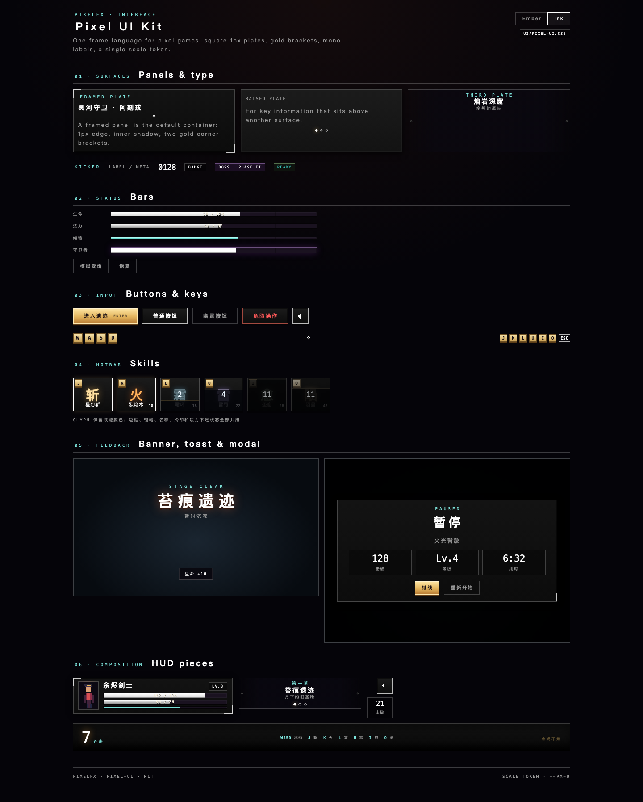

# pixelfx pixel UI kit

A small DOM kit for the games and tools built around pixelfx. It is deliberately square: **1 px frames, hard
2 px bottom edges, no rounded corners, no blur**. Every size is a multiple of one scale token, `--px-u`, so the
same components work at 320×180 in a canvas game, in a full-screen gallery, or in a debug panel.



```
ui/
  pixel-ui.css      tokens + components
  pixel-ui.js       DOM factories and state helpers
  preview.html      every component, two themes, live cooldown/bar demo
  preview.css       layout for the preview page only
```

## Use

```html
<link rel="stylesheet" href="path/to/pixel-ui.css">
<div class="px-ui px-theme-ember" style="--px-u: 1px">
  <div class="px-panel px-panel--framed px-panel--pad">...</div>
</div>
```

```js
import { button, bar, skillSlot, setSkill, modal, icons } from "./pixel-ui.js";

const hp = bar({ tone: "hp", value: 0.8, text: "80 / 100", seg: true });
const slot = skillSlot({ key: "K", glyph: "火", name: "烈焰术", cost: 10, accent: "#ffb05a" });
setSkill(slot, { left: 0.8, total: 1.1, mp: 40, cost: 10 });
```

The game side only needs its own layout CSS. Do not restyle component internals; override the tokens instead.

## The scale token

| host | `--px-u` | result |
|---|---|---|
| 320×180 game stage | `0.1cqw` | every component scales with the stage; 1u ≈ 1.2 px at a 1200 px stage |
| preview / tools | `1px` | natural reading size |
| a tiny embedded panel | `0.8px` | dense, still crisp |

The token is a **length**; use it with `calc(var(--px-u) * n)` in host layout, not with `em` inside components.
In a container-query host, put the token on a child of the container (an element cannot query itself).

## Themes

- Default (`px-theme-ember`): gold/ember dark fantasy.
- `px-theme-ink`: the gallery's black/white/teal shell, for tools rather than a fantasy game.
- Override tokens on any ancestor for a new game: `--px-gold`, `--px-ember`, `--px-panel`, `--px-line`, `--px-hp`,
  `--px-mp`, `--px-xp`, `--px-boss`, `--px-text`, `--px-muted`, `--px-backdrop`, `--px-shadow`.

## Components

| class / factory | purpose |
|---|---|
| `px-panel` `--framed` `--raised` `--flat` `--inset` `--pad` | square surface, optional gold corner brackets |
| `px-plate` | transparent centered plate with top/bottom rules (stage titles) |
| `px-portrait` | framed pixel portrait canvas |
| `px-kicker` `px-display` `px-title` `px-title-sm` `px-sub` `px-label` `px-num` `px-latin` | the one type scale |
| `px-rule` `px-ornament` | dividers and a diamond mark |
| `px-key` `--sm` `--ghost` | keycaps for controls and the hotbar |
| `px-btn` `--primary` `--ghost` `--danger` `--icon` `is-quiet` | one button family |
| `px-bar` `--hp` `--mp` `--xp` `--boss` `--thin` `--seg` | status bars with optional text |
| `px-badge` `--boss` `--danger` `--good` | short states and counts |
| `px-pips` | act/progress pips |
| `px-skill` (`is-ready`, `is-cooling`, `is-nomana`, `is-pulse`, `is-deny`) | hotbar slot with cooldown and mana state |
| `px-combo` | combo counter |
| `px-modal` `is-hidden`, `px-modal__card` `--title` `--wide`, `is-danger` | overlay shell, card, head/body/foot |
| `px-banner` `is-open` | stage/level/boss banners |
| `px-toast` `is-open` | pickup and status toasts |
| `px-stat` / `px-stat-grid` | end-of-run stats |
| `px-controls` / `px-control-group` / `px-keys` / `px-skill-list` / `px-skill-strip` | title controls |
| `px-dock` / `px-sigil` | bottom command bar |
| `px-sr-only` | screen-reader-only text |

The JS factories mirror these classes: `panel`, `key`, `keys`, `button`, `iconButton`, `bar`, `setBar`, `skillSlot`,
`setSkill`, `pulseSkill`, `denySkill`, `badge`, `pips`, `setPips`, `stat`, `statGrid`, `controls`, `skillList`,
`modal`, `banner`, `toast`, `icons`, `el`, `clear`.

## Preview

Serve the repository root and open `ui/preview.html` (for example `npm run gallery` then
`http://localhost:8080/ui/preview.html`). The Ember/Ink switch and the bar/cooldown demos are live.

## Notes

- No external fonts, images or frameworks. Chinese falls through to the system face; Latin labels use a mono stack.
- All motion is optional under `prefers-reduced-motion`.
- `is-hidden` modals set `inert` in the host when appropriate (the game does this in `src/ui.js`).
- MIT, same as the rest of pixelfx. See the repository `LICENSE`.
